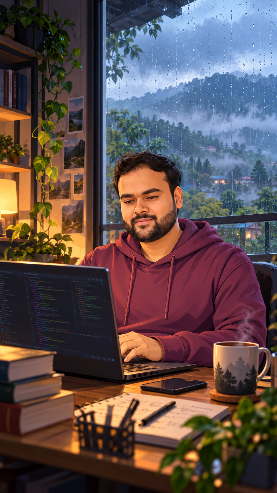

<h2 align="left">👨🏻‍💻 About Me</h2>

<table>
<tr>
<td width="68%" valign="top">

I'm a **Software Engineering Intern at Indian Oil Corporation (IOCL)** and a **Computer Science and Engineering undergraduate specializing in AI/ML at UPES, Dehradun**, passionate about building scalable software, intelligent AI systems, and reliable backend applications.

From **predictive maintenance and machine learning** to **Agentic AI, RAG, and multilingual NLP**, I enjoy turning complex problems into practical solutions that make a real-world impact.

### 🧩 What I Like Building

- 🤖 AI-powered applications that solve real-world problems
- ⚙️ Scalable backend services, REST APIs, and automated workflows
- 🧠 Machine learning, NLP, and RAG-based intelligent assistants
- 🚀 Full-stack applications focused on reliability and usability

### 🏆 Achievements

- 🏅 **Finalist — Hack the Throne 2026**, National-Level Hackathon, IIIT Una
- 🇮🇳 **Smart India Hackathon 2025** — Participant
- 💻 **Snap Syntax — Cognizance, IIT Roorkee 2025** — Participant
- 🛢️ Developed a predictive maintenance system during my internship at IOCL

</td>
<td width="32%" align="center" valign="middle">

</td>
</tr>
</table>

---

<h2 align="left">💻 Technologies I Work With</h2>

  
   
  
   
  

  <i>Building intelligent systems, scalable applications, and solutions that matter. 🚀</i>

